<div align="center">

# 🤖 DevCrew AI

### Your autonomous AI software development team

Submit a software requirement. Seven specialist agents **plan, code, test, review, secure and document** it, and every step is traced.


</div>

---

## ✨ Features

- 🧑‍💻 **7 specialist agents** working like a real software team
- 📡 **LangSmith tracing** for every agent call (latency, tokens, errors)
- 🔐 **Firebase Authentication** (Email + Google) with backend token verification
- 🖥️ **Dark futuristic dashboard**: workspace, history, traces, analytics, settings, architecture
- ⚡ **Groq-powered** fast inference with selectable model and temperature
- 🧪 Auto-generated **pytest** test cases and a **security audit**
- 📄 Final **code + development report** in one run
- 🚀 Deployment on **Vercel** (frontend + backend) with **Firebase** Authentication

## 📸 Screenshots

### 🔐 Login flow
| Sign in | Create account | Access granted |
|:---:|:---:|:---:|
| 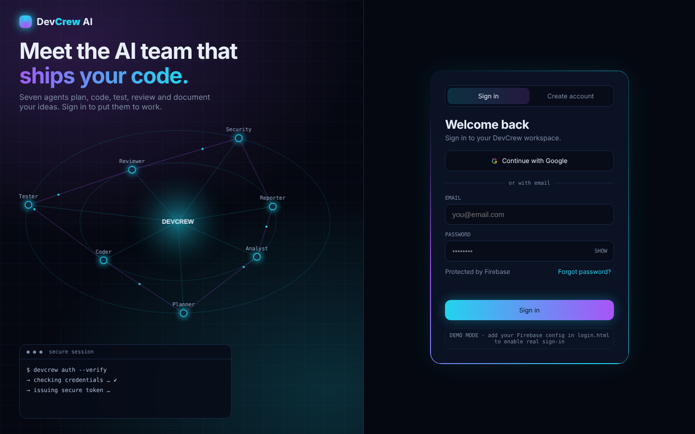 | 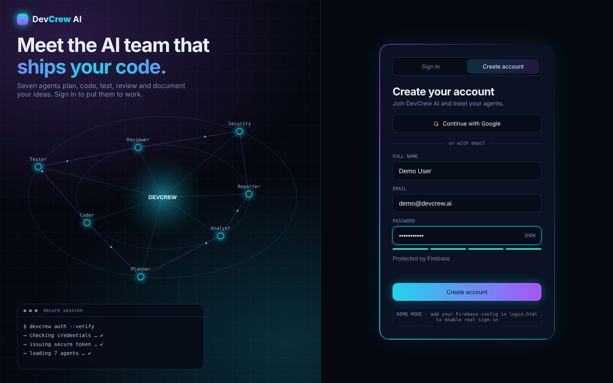 | 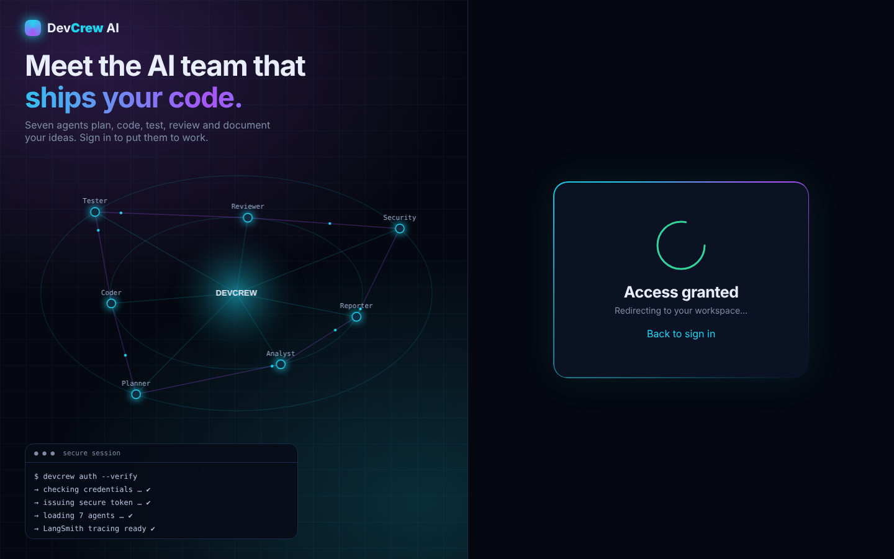 |

### 🖥️ Dashboard
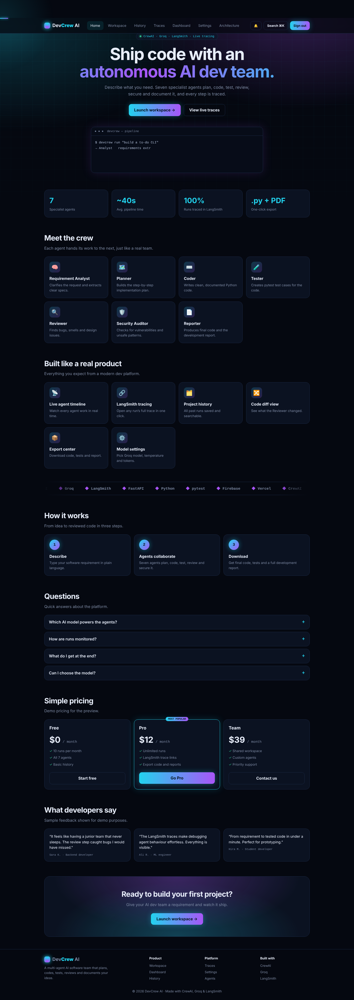

| Workspace | Agent details |
|:---:|:---:|
| 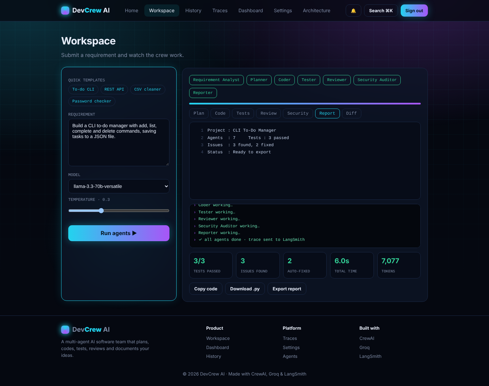 | 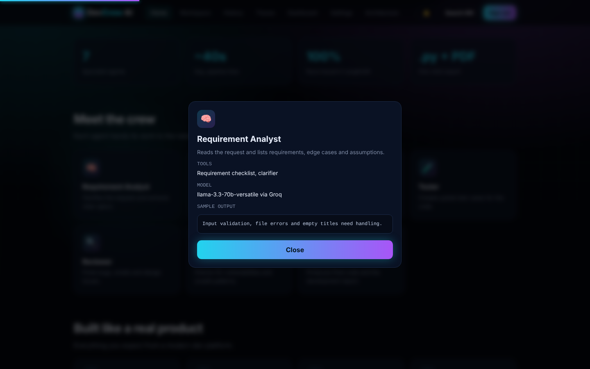 |

| History | LangSmith traces |
|:---:|:---:|
| 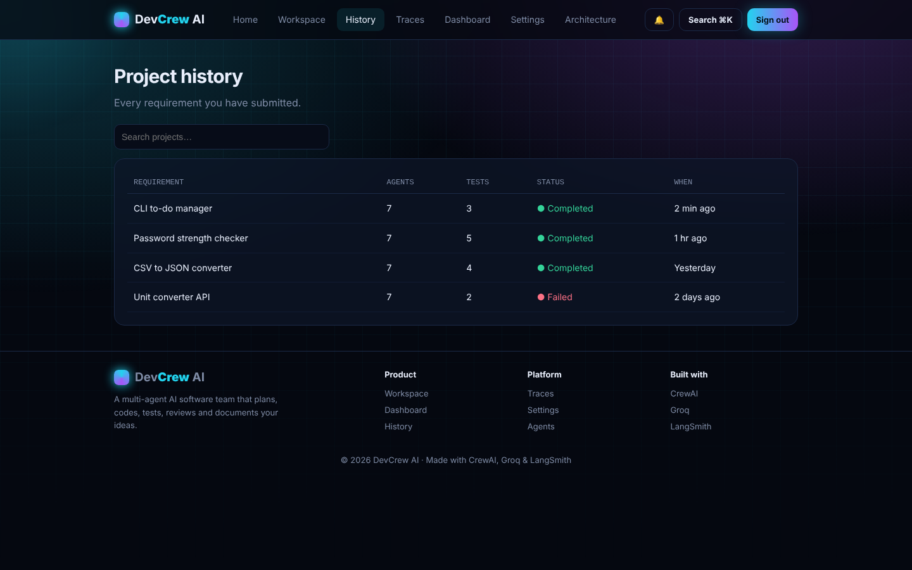 | 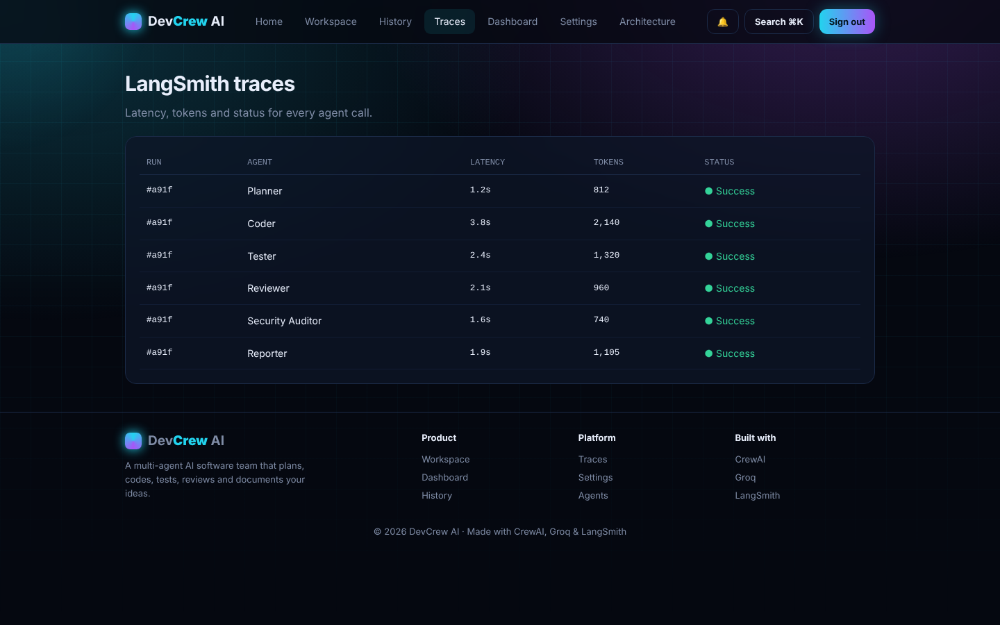 |

| Analytics | Settings |
|:---:|:---:|
| 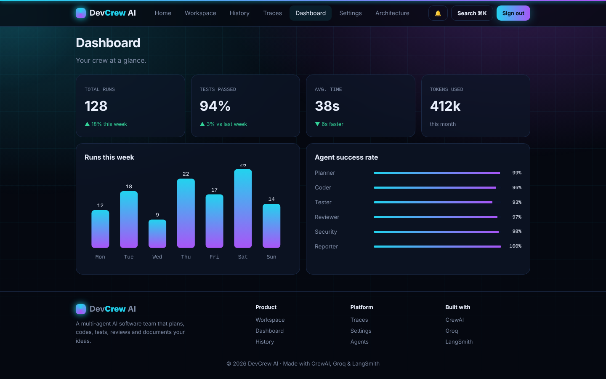 | 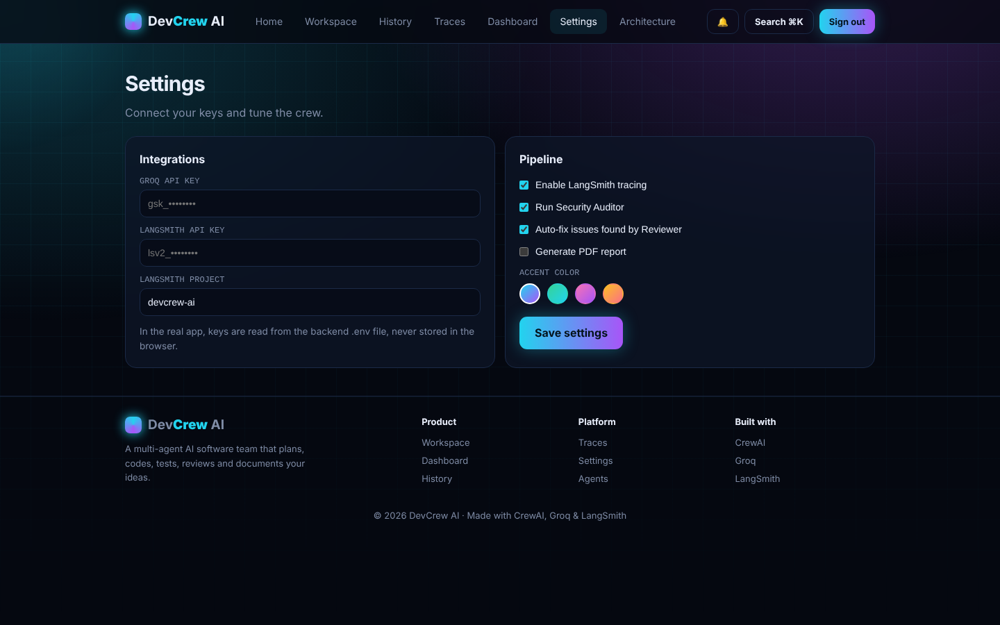 |

| Architecture | Command palette |
|:---:|:---:|
| 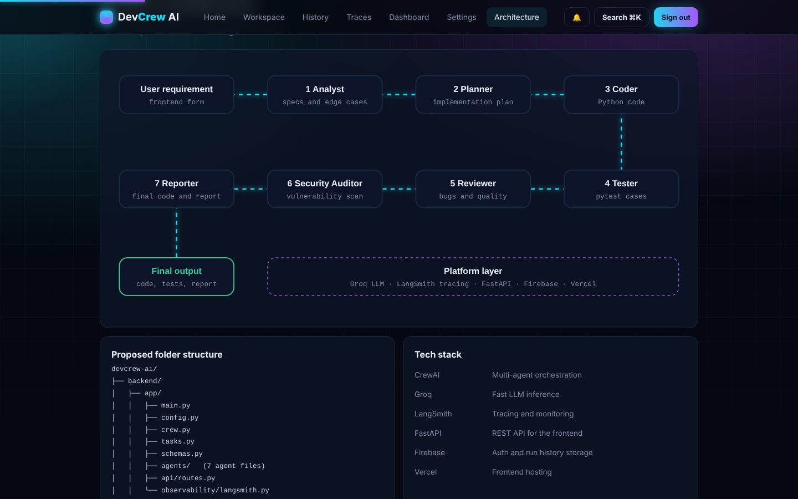 | 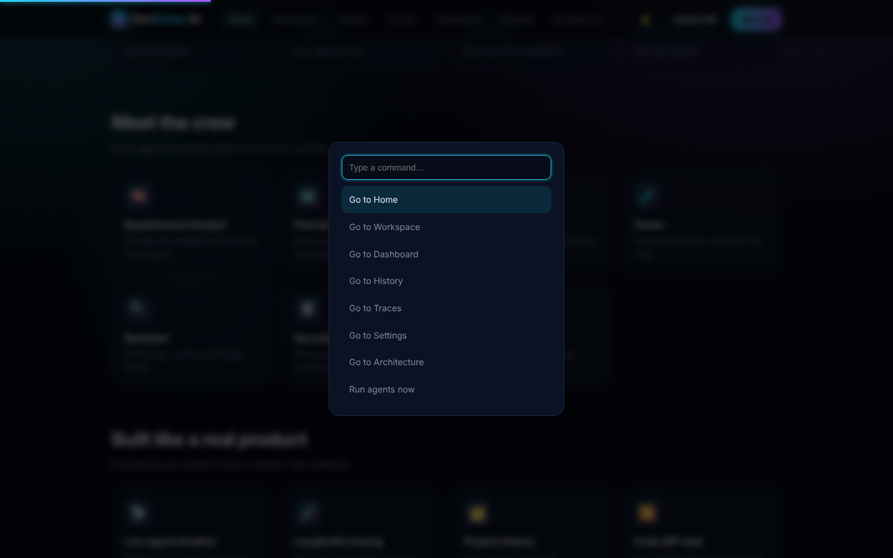 |

<div align="center">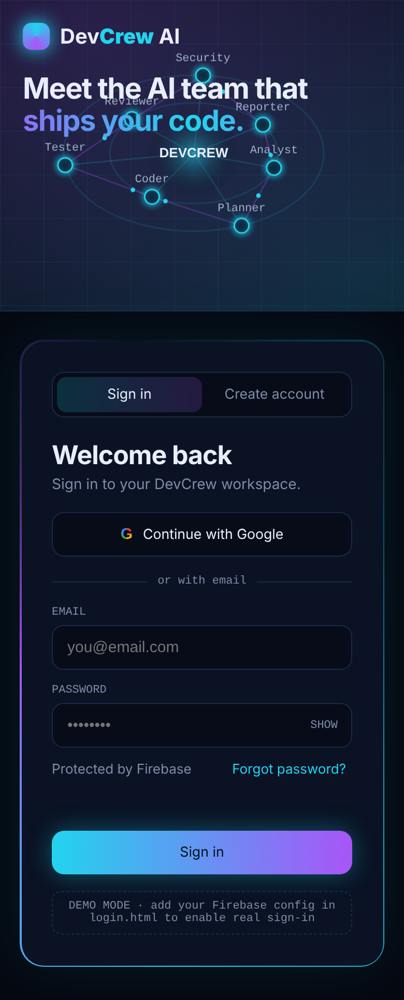<br><sub>Responsive on mobile</sub></div>

## 🔄 User Flow

`Login page (index.html)` → Firebase Email / Google sign-in → `Dashboard (app.html)` → run agents → code, tests, review and report.
The dashboard redirects to the login page when there is no active session, and **Sign out** returns to it.

## 🧠 The Crew

| # | Agent | Responsibility |
|---|-------|----------------|
| 1 | 🧠 Requirements Analyst | Extracts requirements, edge cases and assumptions |
| 2 | 🗺️ Technical Planner | Builds the implementation plan |
| 3 | ⌨️ Python Developer | Generates documented Python code |
| 4 | 🧪 QA Engineer | Writes pytest test cases |
| 5 | 🔍 Code Reviewer | Finds bugs and quality issues |
| 6 | 🛡️ Security Auditor | Audits for vulnerabilities |
| 7 | 📄 Technical Writer | Produces final code and the report |

## ⚙️ Agent Engines

Both engines run the same 7 agent roles defined in `backend/app/agents/roles.py` and both create one LangSmith trace per agent.

| Engine | Installed from | Used for |
|--------|----------------|----------|
| `crewai` | `requirements-crewai.txt` (`crewai` + `openai`) | Local development: CrewAI `Agent`, `Task` and `Crew` for every stage. Groq is reached through its OpenAI-compatible endpoint, so LiteLLM is not needed |
| `groq` | `requirements.txt` (tiny) | Vercel deployment: direct Groq SDK calls, fits the 500 MB bundle limit |

`AGENT_ENGINE=auto` (default) uses CrewAI when it is installed and the Groq engine otherwise.

## 🏗️ Architecture

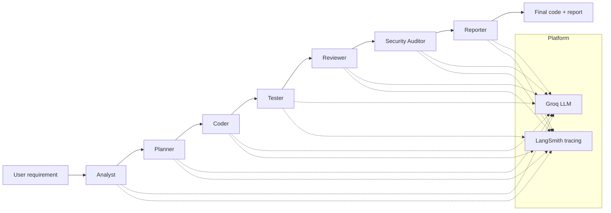

## 📁 Project Structure

```
devcrew-ai/
├── backend/
│   ├── app/
│   │   ├── main.py            # FastAPI app
│   │   ├── config.py          # environment settings
│   │   ├── crew.py            # pipeline + LangSmith traces
│   │   ├── schemas.py         # request/response models
│   │   ├── auth.py            # Firebase token verification
│   │   ├── utils.py
│   │   ├── agents/            # roles.py, factory.py, groq_engine.py
│   │   ├── api/routes.py      # /api/run, /api/health
│   │   └── observability/langsmith.py
│   ├── tests/test_api.py
│   ├── index.py               # Vercel entrypoint
│   ├── vercel.json            # function max duration (300 s)
│   ├── requirements.txt       # lightweight runtime (used on Vercel)
│   ├── requirements-crewai.txt# + CrewAI
│   ├── requirements-dev.txt   # + uvicorn, pytest
│   └── .env.example
├── frontend/
│   ├── config.js              # API_BASE setting
│   ├── index.html             # Login page (entry point, Firebase Auth)
│   └── app.html               # Main dashboard (requires login)
├── docs/
│   ├── DevCrew-AI-Report.docx / .pdf   # project report
│   ├── DevCrew-AI-Presentation.pptx    # 25-slide presentation
│   └── screenshots/           # UI screenshots used in this README
├── firebase.json              # optional: Firebase Hosting for the frontend
└── README.md
```

## 🚀 Getting Started

```bash
# 1. Backend
cd backend
python -m venv .venv && source .venv/bin/activate    # Windows: .venv\Scripts\activate
pip install -r requirements-dev.txt
cp .env.example .env                                  # add your keys
uvicorn app.main:app --reload                         # http://localhost:8000/docs

# 2. Frontend (new terminal)
cd frontend
python -m http.server 5500                            # http://localhost:5500 (opens the login page)
```

## 🔌 Connecting Frontend and Backend

1. Start the backend (`uvicorn app.main:app --reload`, default `http://localhost:8000`).
2. Open `frontend/config.js` and set `API_BASE` to the backend URL (your backend Vercel URL after deployment).
3. Add the frontend origin to `ALLOWED_ORIGINS` in `backend/.env`.
4. Sign in and press **Run agents**. The workspace calls `POST /api/run` with your Firebase ID token, shows the real output of every agent and fills History and Traces. If the backend is unreachable, the workspace falls back to a demo animation.

## 🔑 Environment Variables

| Variable | Purpose |
|----------|---------|
| `GROQ_API_KEY` | Groq LLM access |
| `GROQ_MODEL` | Default model (`openai/gpt-oss-120b`) |
| `AGENT_ENGINE` | `auto` (default), `crewai` or `groq` |
| `LANGSMITH_API_KEY` | Enables LangSmith tracing |
| `LANGSMITH_PROJECT` | Trace project name |
| `REQUIRE_AUTH` | `true` to require Firebase login |
| `FIREBASE_PROJECT_ID` | Firebase project for token checks |
| `ALLOWED_ORIGINS` | CORS origins |

## 📡 API

| Method | Endpoint | Description |
|--------|----------|-------------|
| `GET` | `/api/health` | Health check |
| `POST` | `/api/run` | Run the 7-agent pipeline |

```json
POST /api/run
{ "requirement": "Build a CLI to-do manager with add, list, complete and delete.", "temperature": 0.3 }
```

## 🔭 LangSmith Tracing

Set `LANGSMITH_API_KEY` and each run creates a `devcrew_pipeline` trace with one child run per agent (`agent:coder`, `agent:tester`, ...). Open [smith.langchain.com](https://smith.langchain.com) to inspect latency, tokens and outputs.

## 🧪 Testing

```bash
cd backend && pytest -q
```

## ☁️ Deployment (Firebase + Vercel only)

| Part | Platform |
|------|----------|
| Authentication | **Firebase Authentication** (Email + Google) |
| Backend API | **Vercel** (Python / FastAPI, Root Directory `backend`) |
| Frontend | **Vercel** (Root Directory `frontend`) or **Firebase Hosting** |

### 1. Firebase (login)
1. Open the [Firebase Console](https://console.firebase.google.com) and create a project.
2. **Build > Authentication > Get started**, then enable **Email/Password** and **Google**.
3. **Project settings > Your apps > Web app (`</>`)**: copy the config into `frontend/config.js` (`FIREBASE` block).
4. After the frontend is deployed, add its domain under **Authentication > Settings > Authorized domains**.

### 2. Backend on Vercel
1. Push this repository to GitHub.
2. In Vercel choose **Add New > Project**, import the repo and set **Root Directory = `backend`** (FastAPI is detected automatically; `index.py` is the entrypoint).
3. Add these **Environment Variables**: `GROQ_API_KEY`, `GROQ_MODEL`, `LANGSMITH_API_KEY`, `LANGSMITH_TRACING=true`, `LANGSMITH_PROJECT`, `REQUIRE_AUTH=true`, `FIREBASE_PROJECT_ID`, `ALLOWED_ORIGINS` (your frontend URL).
4. Deploy and check `https://<your-backend>.vercel.app/api/health` and `/docs`.

`backend/vercel.json` sets the function duration to **300 seconds** (the Hobby plan maximum with Fluid compute) because one run makes seven sequential model calls.

### 3. Frontend
- **Vercel:** create a second project from the same repo with **Root Directory = `frontend`**, Framework Preset **Other**, no build command.
- **Firebase Hosting:** `npm i -g firebase-tools`, `firebase login`, then `firebase deploy --only hosting` (`firebase.json` serves the `frontend` folder).

Finally set `API_BASE` in `frontend/config.js` to your backend URL, redeploy the frontend, and make sure the frontend URL is in the backend `ALLOWED_ORIGINS`.

### Limits to know
- **Groq free-tier rate limits:** each model has a small tokens-per-minute limit, so every agent has an output token budget and earlier outputs are clipped before being passed on. A full run can take a few minutes on the free tier (the SDK waits and retries on rate limits). If you see `413 Request too large` or `429`, wait a minute, use `openai/gpt-oss-20b`, or upgrade the Groq tier.
- Vercel Python functions have a **500 MB uncompressed bundle limit** and CrewAI has many dependencies. For that reason `backend/requirements.txt` does **not** include CrewAI: on Vercel the lightweight **Groq engine** runs the same 7 agent roles (see *Agent Engines*). To try full CrewAI on Vercel, add `crewai` to `requirements.txt` and check the build size with `VERCEL_ANALYZE_BUILD_OUTPUT=1`.
- Run history is stored in the browser (`localStorage`) because serverless functions are stateless.
- Vercel limits can change, so confirm them in the Vercel docs before the final deployment.

## 🗺️ Roadmap

- [ ] Streaming agent progress (SSE)
- [ ] Firestore run history
- [ ] Downloadable PDF reports
- [ ] Custom agents per team

## 👩‍💻 Author

**Anushay Ayat** · [GitHub](https://github.com/scientistayat-engineer)

<div align="center">⭐ If you like this project, give it a star!</div>
